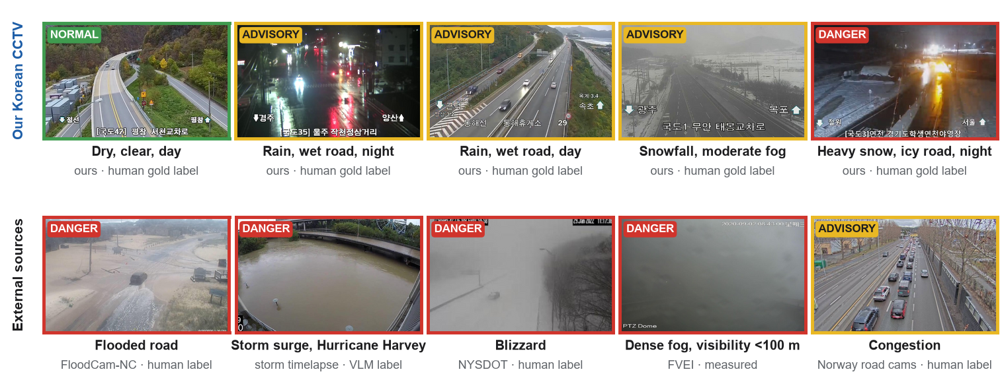
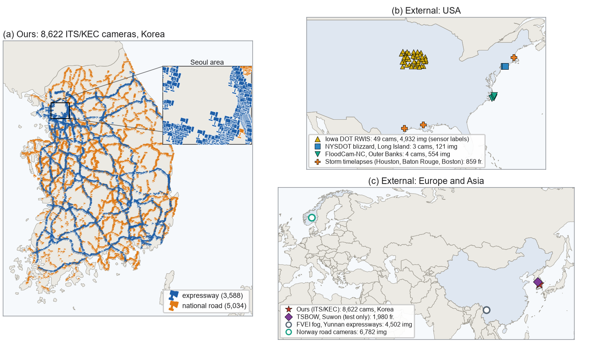
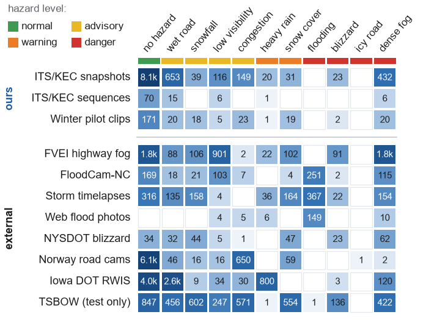
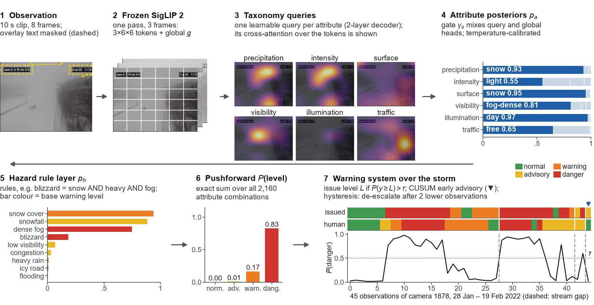
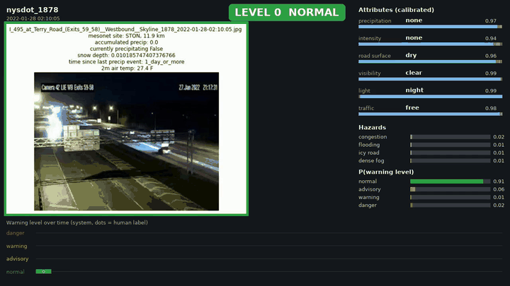
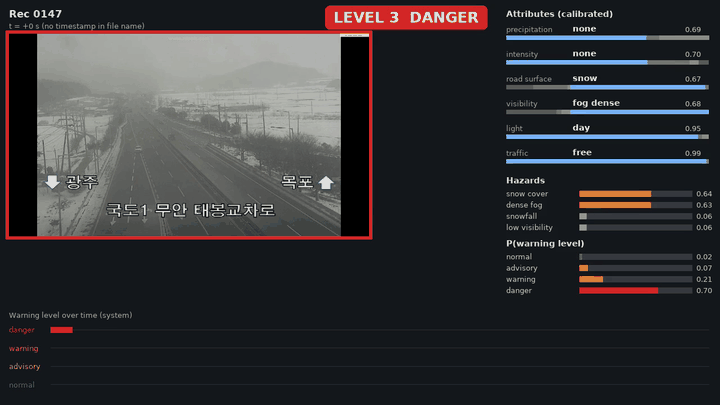

# HighwayMM: A Taxonomy-Grounded Benchmark and Early-Warning System for Road Weather Hazards from Roadside CCTV

**Project page: https://highwaymm.github.io/HighwayMM/**

> **Status:** code release accompanying an anonymous submission (under review).
> The dataset (frames, labels, features) will be released after review. See [Data and licences](#data-and-licences).



Roadside CCTV cameras watch almost every kilometre of modern highways, yet they are rarely used to **warn** drivers about weather hazards.
**HighwayMM** is a benchmark and a reference system for recognising road-weather hazards and issuing early warnings from fixed roadside cameras.

- **9,031 clips from 8.8k Korean expressway and national-road cameras**, combined with **seven external sources** chosen to fill their gaps:
  - highway fog (FVEI);
  - coastal road flooding (FloodCam-NC);
  - an unseen blizzard (NYSDOT);
  - hurricane and storm-surge timelapses (V-FloodNet);
  - Nordic road cameras (traffic levels);
  - summer storms from Iowa DOT roadside weather-station cameras, with sensor labels;
  - Korean city CCTV from TSBOW, used as a test-only source.
- **A unified hazard taxonomy:** 6 observable attributes → 9 hazard types → 4 warning levels. It merges datasets with incompatible label sets without relabelling ([docs/TAXONOMY.md](docs/TAXONOMY.md)).
- **Overlay-masked inputs and camera-disjoint splits.** Test sets use human, physics or sensor labels only. A **human-labelled gold set** covers our own footage.
- **An end-to-end early-warning system:**
  - calibrated warning levels by exact taxonomy pushforward;
  - onset detection, hysteresis and multi-camera aggregation;
  - evaluated by recall at a fixed false-alarm rate, false alarms per camera-day, lead time and throughput.

<p align="center"></p>
<p align="center"></p>

## How it works



*One observation from an unseen blizzard camera through every stage; all values are outputs of the released model.*
1. Burned-in overlay text is masked.
2. A frozen SigLIP 2 pass gives patch tokens and a global embedding.
3. One query per taxonomy attribute cross-attends to the tokens.
4. A learned gate mixes each query head with a global head, giving calibrated attribute posteriors.
5. A soft rule layer derives the nine hazards.
6. The exact taxonomy pushforward gives the warning-level distribution.
7. Over the storm, the warning system issues levels with an early advisory and hysteresis.

The per-attribute attention on more scenes is in [docs/assets/query_attention.png](docs/assets/query_attention.png).

## Key findings

| Model (frozen SigLIP 2 features unless noted) | 8 external tests, GT-mean | Warning F1 | Gold set (ours), attribute F1 |
|---|---|---|---|
| SigLIP 2 zero-shot | 60.7 | 29.1 | n/a |
| Qwen2.5-VL-7B, prompted (also our pseudo-labeller) | 64.7 | 63.0 | **47.0** |
| Flat weather classes | 69.1 | 54.1 | 43.3 |
| ConvNeXt-B, fine-tuned end to end | 75.7 | 57.6 | 40.4 |
| Linear probe + taxonomy pushforward | 79.2 | 64.9 | 44.4 |
| MLP probe + taxonomy pushforward | 80.7 | **66.8** | 46.2 |
| MLP probe + object-detection descriptors | **81.1** | 65.1 | 46.9 |
| TaxoWarn-S (taxonomy-query model) | 79.8 | 64.4 | 43.0 |

The numbers are means over 3 seeds; full tables with standard deviations are in [docs/RESULTS.md](docs/RESULTS.md).

1. **Taxonomy-factorised supervision is essential.** Learning the same data as flat weather classes loses more than 10 points (fog F1 drops from about 92 to 35).
2. **Prompting a large VLM is not enough.** Qwen2.5-VL-7B is near chance on flooding (48.5 AUROC) and collapses fog grades (39.8 F1).
3. **Data coverage, not architecture, drives accuracy.**
   - Training on our footage alone gives 64.1 GT-mean; training on external data alone gives 73.7.
   - Removing the summer source drops wet-road AUROC from 87.2 to 75.7.
   - Our interpretable TaxoWarn-S is competitive with an MLP probe but not better.
4. **Open problem: the source domain.** On our own cameras, every trained model only *matches* the VLM whose pseudo-labels it learned from (46–47 attribute F1).
   - An audit of VLM-mined hazard candidates shows that most night-time "snow" is rain seen by infrared cameras.
   - Flooding on unseen cameras remains unsolved (AUROC ≤ 64 for all methods).
5. **Early warning:**
   - snow cover through an unseen blizzard is detected at **85% recall with 0.03 false alarms per camera-day**;
   - the pipeline serves **about 1,040 cameras per RTX 3090** at one clip per minute.

## Replay demo: the warning system on recorded footage

`code/warning/live_demo.py` runs the complete pipeline on any video or image files as if they were arriving live:
8 frames per observation → OCR overlay masking (same rules as training) → SigLIP 2 → TaxoWarn-S (6 attributes, 9 hazards,
calibrated) → warning system (thresholds, early advisory, hysteresis). It prints a live feed and writes an event log,
timelines, an annotated video per camera and a self-contained HTML report. It can also watch a drop folder for new files.

<p align="center"></p>

*NYSDOT camera 1878 through the January 2022 blizzard (unseen in training). The frame border and badge show the issued level; the bottom strip shows the level so far, with dots for the human labels.*

```bash
python code/warning/live_demo.py --input my_videos/ --out demo_out/ --gif     # one sub-folder per camera
python code/warning/live_demo.py --input dashcam.mp4 --camera cam1 --window 5 --speed 10 --out demo_out/
python code/warning/live_demo.py --watch drop_folder/ --out demo_out/            # process files as they appear
```

The replay reproduces the paper exactly. Run on the held-out FloodCam and NYSDOT cameras with the paper's operating points, it gives the warning numbers reported in the paper. See [docs/DEMO.md](docs/DEMO.md) for the trained weights, all options and limitations.

<p align="center"></p>

## Repository layout

```
code/
  data/       manifests, frame extraction + OCR overlay masking, VLM pseudo-labelling, sensor/physics labels,
              SigLIP 2 / spatial / object-detection features, gold-set and hazard-mining tools, taxonomy.py
  models/     TaxoWarn (v1, temporal) and TaxoWarn-S (taxonomy queries over spatial tokens)
  train/      trainer, configs, experiment grids, job runner, evaluation (external tests and gold set)
  warning/    early-warning system (decision, CUSUM onset, hysteresis, aggregation), evaluation, throughput,
              replay demo (live_demo.py), checkpoint export (export_model.py)
  report/     generators for every paper table and figure, the Overleaf export and this repository
docs/         RESULTS.md, TAXONOMY.md, REPRODUCE.md, DATA.md, DATASHEET.md, DEMO.md
```

## Getting started

```bash
python -m venv .venv && .venv\Scripts\activate          # Python 3.12; Linux: source .venv/bin/activate
pip install -r requirements.txt                          # CUDA 12.1 wheels for torch 2.5.1
```

The full pipeline (frames → labels → features → training → evaluation → tables) is described step by step in [docs/REPRODUCE.md](docs/REPRODUCE.md).

> **Note:** The research code currently uses absolute paths under `D:\highwaymm` (Windows). Experiments honour `EXP_ROOT`. Adjust the path constants at the top of each script before running elsewhere; a single path configuration will come with the data release.

## Data and licences

| Part | Release |
|---|---|
| Our ITS / KEC snapshots and pilot clips | Overlay-masked frames, metadata, labels with per-attribute provenance, features. Licence plates and faces are blurred; 16 non-traffic files are excluded |
| Gold labels, hazard-mining audit | Released with the dataset |
| NYSDOT 511NY (CC BY 4.0), FloodCam-NC, Pixabay flood images | Redistributed with attribution |
| FVEI, V-FloodNet sequences, Norway road cameras, Iowa DOT RWIS (all rights reserved), TSBOW (CC BY-NC-ND) | **Item IDs plus download and preprocessing scripts only** |

See [docs/DATA.md](docs/DATA.md) and the [datasheet](docs/DATASHEET.md).

## Citation

```bibtex
@inproceedings{highwaymm,
  title     = {HighwayMM: A Taxonomy-Grounded Benchmark and Early-Warning System for Road Weather Hazards from Roadside CCTV},
  author    = {Anonymous},
  booktitle = {Under review}
}
```

## Licence

The code is released under the MIT licence ([LICENSE](LICENSE)). Each data source keeps its own licence (see above).
